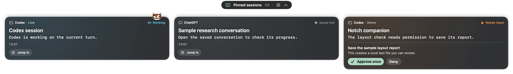

# watchnotch


[Website and Mac download](https://erezlev13.github.io/watchnotch/)

A local macOS app for following selected Codex and ChatGPT sessions. Click the strip by the camera or use the menu bar item to expand it. The owl perches on the pinned live session with the latest status update. When only demo activity is available, it follows the demo. Saved ChatGPT links do not report live activity. The centered row grows with your pins. Each tile is at most 300 points wide, and the number that fit depends on the display. Moving to a smaller display preserves existing pins. Each tile types a single status line in white and shows its own pending decision or result. Reduce Motion displays new sentences immediately. On a narrow display, scroll the row horizontally.



## Build and open

On this Mac, run the following from the `mac/` directory.

```sh
./scripts/build.sh
open ".build/watchnotch.app"
```

The app starts with three labeled demo cards. Open the sliders or choose **Session library…** in the menu bar to search local sessions and manage pins. The library reads the local ChatGPT desktop catalog when opened. The ChatGPT tab also offers browser history lookup and account export import for chats outside the catalog. Imports retain titles, IDs and dates on this Mac. Pins retain their order across launches. The menu bar item also lets you quit.

| Source | How to connect | What the card can do |
| --- | --- | --- |
| Codex | Select a session in the searchable library, or use Add link and enter its UUID or codex://threads/ link. The local App Server must recognize that ID. | Shows a short update from the latest visible agent message or recognized activity, checked about every 2.5 seconds. Jump in opens the thread by UUID. Add its web address in Manage sessions when a cloud counterpart exists. The monitor reconnects after a service interruption. |
| ChatGPT | Use Find ChatGPT chats, or paste the private conversation URL under Add link. Optionally enter a title. | Saves the link locally and returns to its open desktop window when identifiable, then tries an app-associated link, then the default browser. Check the conversation itself for progress and approvals. |
| Demo | Pin a sample from the picker. Replay demo events resets the timeline. | Simulates overlapping requests to save a layout report and export a vendor shortlist. Approve once writes the selected session’s sample file. Deny skips it. Decisions expire after two minutes. |

The packaged app observed a real, disposable Codex App Server thread run a ten-second sleep. Separate verification observed ready, running, completion, disconnect and reconnect. Native desktop thread observation and real approval delivery still need an end-to-end test with a desktop-created thread. ChatGPT Accessibility access was unavailable to the test process. The saved-link test used synthetic IDs. The expanded panel exposes action buttons only when a provider supplies an actionable request.

The prototype stores pins, sample outputs and adapter snapshots in the user's Application Support folder under Mac Notch Session Companion. Opening the library lists local thread titles and IDs. The Active filter refreshes about every five seconds while the library is open. It includes working and waiting Codex threads and ChatGPT conversations marked active in the desktop catalog. Browser and export links have no live signal. Detailed activity is requested only for pinned Codex threads. The tile’s info button shows the configured model, reasoning effort and token count from that thread’s local record when available. Direct ChatGPT URLs are stored locally. The two integration notes contain exact versions and reproduction steps. [Codex adapter](Adapters/Codex/README.md) · [ChatGPT adapter](Adapters/ChatGPT/README.md)

## Jump back to a session

Choose **Jump in** on a linked tile, including while a decision is pending. The panel collapses after macOS accepts the handoff. **Open result** remains a separate action. Control-click **Jump in** and choose **Open in browser** to use the saved web address directly.

For ChatGPT, the companion can raise an open provider window when macOS Accessibility already permits reading its document URL and it matches the pinned conversation. It also tries an eligible macOS universal link when the provider is running. Otherwise the exact private URL opens in your default browser. Codex local UUIDs have a desktop thread route. To pair a web counterpart with an existing Codex pin, enter its UUID and the corresponding private web URL in Manage sessions. A desktop handoff receipt confirms macOS accepted the URL; the provider handles thread loading and account access.

## Verify

```sh
./scripts/test.sh
/usr/bin/python3 -B Adapters/Codex/verify.py
/usr/bin/python3 -B scripts/verify-panel.py
/usr/bin/python3 -B scripts/verify-panel.py --five
```

The first script tests session identity, pin persistence, adaptive tile width and pin capacity, result creation, and duplicate, expired and disconnected decisions. The Codex check needs the running local daemon. The final two commands also need a graphical desktop. They use disposable directories, capture only the companion's own window and save the images to Demo.

Coucou inspired the small notch strip and the ability to act on a session without switching windows. [Coucou](https://github.com/Louis-CFM/coucou)
