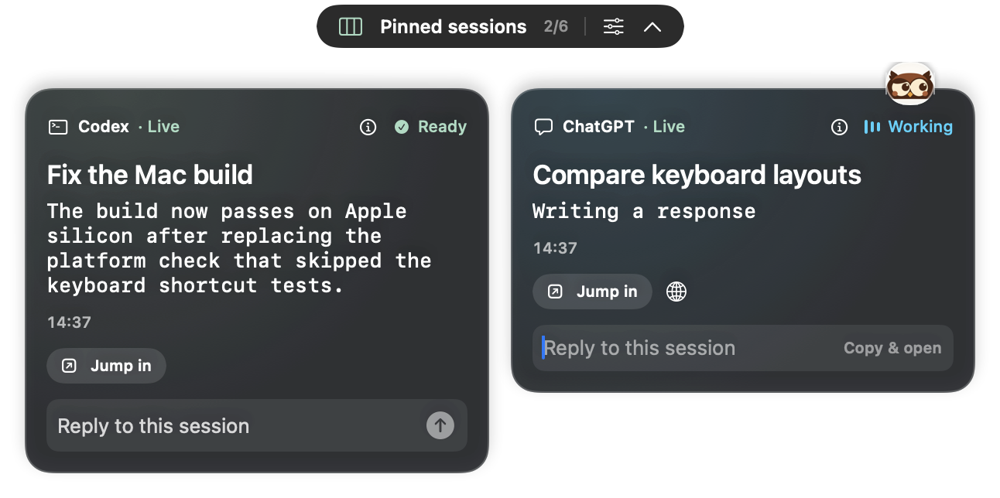

# watchnotch


[Mac preview 0.1.7](https://github.com/erezlev13/watchnotch/releases/tag/v0.1.7) · [Website](https://erezlev13.github.io/watchnotch/)

Watch selected ChatGPT Chat and Work conversations and Codex threads from the notch on your Mac. Click the strip by the camera or use the menu bar item to expand the pinned row. The owl follows the latest live update. Each tile shows one sentence about progress, a result, or what needs your attention. Its lines appear from top to bottom. An arriving update waits for the current sentence to finish and gives you time to read it. Click the sentence to reveal it immediately, or enable Reduce Motion to see it in full.

A subagent appears inside its pinned parent while working or waiting for input and disappears when its turn ends. Click a subagent or fork to open its thread. Each pinned tile is at most 300 points wide. Your display determines how many fit. On a smaller screen, scroll horizontally to reach existing pins.



The public 0.1.7 download includes queued summaries and active subagent tiles. The source build also keeps quiet ChatGPT conversations connected and restores monitoring when the desktop app reopens. [Watch three queued updates](../docs/media/vertical-summary.gif)

[Watch the 64-second feature film](https://erezlev13.github.io/watchnotch/#tour) for a walkthrough of the download, public source build and features in development. The film uses example conversations.

## Build and open

On this Mac, run the following from the `mac/` directory.

```sh
./scripts/build.sh
open ".build/watchnotch.app"
```

The app starts with three labeled demo cards. Open the sliders or choose **Session library…** in the menu bar to search local sessions and manage pins. Choose **Active** to find sessions that are working or waiting for input. You can also paste a private ChatGPT conversation link into search. The ChatGPT tab also offers browser history lookup and account export import for chats outside the catalog. Imports retain titles, IDs and dates on this Mac. Pins retain their order across launches. The menu bar item also lets you quit.

| Source | How to connect | What the card can do |
| --- | --- | --- |
| Codex | Pin a local thread from the library, or use **Add link** with its UUID or desktop link. | Shows a summary from visible agent messages and recognized activity. The ⓘ button shows the configured model, reasoning effort and account usage percentages when available. Use the reply arrow to send to the selected thread. |
| ChatGPT and ChatGPT Work | Pin a conversation from the desktop catalog, browser history or an export, or paste its private conversation link. | Shows status supplied by the desktop app. Use the reply arrow to submit through the ChatGPT desktop composer with macOS Accessibility permission. A conversation known only by its link can still open in the browser. |
| Demo | Pin a sample from the picker. **Replay demo events** resets the timeline. | Simulates a question with two answer choices, independent approvals and replies. Approve once writes the selected session’s sample file. Deny skips it. Decisions expire after two minutes. |

## Answer a question or approval

In the source build, a pending question takes the place of the animated update. Read the full prompt and click a choice. If Codex asks several questions together, select each answer and click **Send answers**. A command approval shows what Codex wants to run and offers a one-time decision. Other tiles keep their own controls.

For ChatGPT Chat and Work, open the pinned conversation in the Mac app and enable **Accessibility** for watchnotch in System Settings. The tile can mirror supported single-choice questions and one-time approvals while their controls are visible. Use **Open session** when the provider reports that it needs input without exposing usable controls.

## Reply from the notch

Expand the pinned row and type in **Reply to this session** below **Jump in**. Drafts stay with their own tile when you switch tiles or collapse the row. Press Return or click the arrow to send to a connected Codex thread or desktop ChatGPT conversation. If the thread is offline or awaiting input, use **Copy & open** to continue in the original session. For desktop Chat and Work, allow watchnotch in **System Settings → Privacy & Security → Accessibility**. Watchnotch checks the open conversation ID before entering the draft. Control-click the send arrow for **Copy & open**.

The Codex monitor polls its local App Server about every 2.5 seconds. ChatGPT activity refreshes about every three seconds while a conversation is pinned or the library is open. A quiet desktop conversation shows **Watching**. If ChatGPT closes, its indexed pins go offline and reconnect when it reopens. The desktop app may report an active Work turn before supplying its title. watchnotch displays that conversation by ID until the title arrives. Account exports and browser imports supply conversation links. Live updates depend on a matching desktop activity signal.

Pins, demo outputs and snapshots are stored locally in the Mac Notch Session Companion folder under Application Support. Independent disposable Codex threads were used to verify delivery of distinct replies to the selected sessions. [Codex adapter](Adapters/Codex/README.md) · [ChatGPT adapter](Adapters/ChatGPT/README.md)

## Mac features in development

These instructions refer to the combined local preview at revision `1f0dd9d1972ba3af7bfaf1803eb022ced71458da`. The Mac test suites and signed build passed.

The development build expands a tile’s draft to six lines, then scrolls. Shift-Return inserts a line break. To add one screenshot, copy a selection with Control–Shift–Command–4, then paste in the reply field or choose **Paste image**. Use the × beside its thumbnail to remove it.

For a connected Codex thread, the send arrow submits the image and optional caption together. For ChatGPT, **Copy image & open** places the screenshot on the clipboard. Paste and send it in the destination conversation. Watchnotch can stage the caption in an empty desktop composer, and **Copy text & open** makes the caption available separately.

With Accessibility access, an open, pinned ChatGPT conversation can also show a short preview of its last observed assistant reply. Scroll to the bottom of the transcript so watchnotch can observe the latest reply. The preview stays in memory and can show up to 240 characters. A matching open window can connect a pin even before its catalog entry appears. When the desktop composer offers **Queue** during an active turn, the tile can send a follow-up and show **Queued in ChatGPT**.

### Claude Desktop and Claude Code

In the local development build, open **Session library → Claude**. Paste a private Claude Desktop chat link, pin it and use **Jump in** to return to the conversation. **Copy & open** hands off a draft. Choose **Enable Claude Desktop activity…** and grant Accessibility access to discover open chats. The open chat’s title, URL and English composer controls supply its identity and activity. A visible Stop response button indicates that Claude is working.

Claude Code discovery requires an installed CLI that supports `claude agents --json --all`. Its local session list reports working, waiting and ready states. Use **Copy attach command** for a background job or **Copy resume command** for an interactive session. Run the copied command in the project terminal. Review questions and permissions in Claude Code. When automatic display is enabled, an active Claude Code session can appear before you pin it.

The Claude feature build was checked on a Mac with a free Claude Desktop account. **Jump in** reopened the exact chat after switching to another conversation. Watchnotch also discovered a saved Claude Code background job whose last recorded state was **Needs input**. When the CLI supplies neither a process ID nor live status, the current build marks the job unavailable. Its description can still show the last reported activity. The live Desktop transition from **Working** to **Ready** and resuming a signed-in Claude Code model turn are still unverified.

### Automatic display and session controls

In the development library, enable **Automatically show active sessions** to show working sessions and sessions waiting for input beside your pins. Temporary tiles disappear when idle, and manual pins keep their order. Use **+** in the expanded strip to open a fresh Codex, ChatGPT or ChatGPT Work composer. The ChatGPT option can open a new browser chat if the desktop app is unavailable.

On a Codex tile, **End session** asks you to confirm **End and archive**. The thread history stays in the archive and its tile is removed. On a desktop ChatGPT tile, **Stop response** stops a turn when the matching composer exposes the control and Accessibility is enabled. The chat remains available. Approval choices preserve the scope shown by the desktop app, including labels such as **Allow this conversation** and **Cancel** when offered.

For local rebuilds, the development build script uses a single available Apple Development identity automatically. With several identities, set `WATCHNOTCH_SIGNING_IDENTITY` to the certificate fingerprint. Keeping the same signer and installed copy helps preserve Accessibility access. An ad-hoc rebuild can require a fresh grant.

## Jump back to a session

Choose **Jump in** on a linked tile, including while a decision is pending. The panel collapses after macOS accepts the handoff. **Open result** remains a separate action. Control-click **Jump in** and choose **Open in browser** to use the saved web address directly.

For ChatGPT, **Jump in** looks for the selected conversation in the running desktop app. macOS Accessibility permission can help watchnotch find it in the app’s navigation. Use the globe button to open the private web address directly. If the desktop app is closed, the conversation opens in your default browser.

Codex threads use their desktop UUID route. Pair a cloud counterpart by entering the local UUID and the private web URL in Manage sessions. The provider handles thread loading and account access.

## Verify

```sh
./scripts/test.sh
/usr/bin/python3 -B Adapters/Codex/verify.py
/usr/bin/python3 -B scripts/verify-panel.py
/usr/bin/python3 -B scripts/verify-panel.py --five
```

The first script tests session identity, pin persistence, adaptive tile width and pin capacity, result creation, and duplicate, expired and disconnected decisions. The Codex check needs the running local daemon. The final two commands also need a graphical desktop. They use disposable directories, capture only the companion's own window and save the images to Demo.

Coucou inspired the small notch strip and the ability to act on a session without switching windows. [Coucou](https://github.com/Louis-CFM/coucou)
